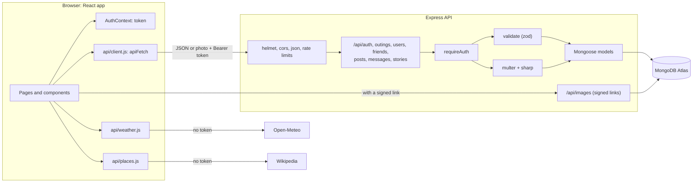

# Meshwar

A weather-aware outing planner for students in Lebanon. Save a hike, a beach day or a ski trip, and Meshwar shows the forecast for that exact day and place, with a plain verdict: **Good to go**, **Bring a jacket**, or **Rain likely, consider rescheduling**.

> The first proposal spelled the name "Mishwar". It is the same project.

**Live app:** https://meshwar-rho.vercel.app
**Live API:** https://meshwar-api-l824.onrender.com (health check: https://meshwar-api-l824.onrender.com/api/health). The API runs on Render's free tier, which sleeps after 15 idle minutes, so the first request can take up to a minute.

**Team:** Wadih Tawk, Alex Achkar, Raymond El-Helou

## Features

- Sign up, log in and log out. Passwords are hashed with bcrypt; login returns a JWT.
- Create an outing: title, activity (hike, beach, ski, picnic, city, other), date, notes, and a place searched by name. The user picks the right match from a list, because "Tripoli" returns Libya first and Lebanon second.
- **My outings:** only your own outings, upcoming ones sorted by date, past ones in their own section.
- **Outing page:** that day's forecast (min and max °C, rain chance, wind) and the verdict. The forecast covers today and the next 14 days; later dates show "Forecast available from <date>". If the weather service has not finished a day's forecast, the app says so instead of guessing a verdict.
- **Photos and place info:** every outing shows a photo of its place and a short "About" text from Wikipedia, plus up to four sights nearby to explore (castles, temples, ski areas, valleys…). When Wikipedia has no photo, the app shows a photo for the activity.
- **Home page:** a greeting by name, the next outing with a countdown ("In 3 days"), and **ideas for your next outing**: fourteen places around Lebanon with a photo, a short description and this Saturday's forecast. **Plan an outing here** opens the form already filled in.
- **Idea pages** (`/ideas/...`): a photo gallery, what the place is, what to do, where to eat or stay, stops with directions (for the Bekaa wine trail), tips, this Saturday's forecast and a map. New places include the MIM Mineral Museum, Zaitunay Bay, Our Lady of Lebanon in Harissa, the National Museum of Beirut, Beirut Souks and a wine day in the Bekaa (Château Ksara, Massaya, Château Héritage, Domaine de Taanayel; staying at Chtaura Park Hotel or Massabki Hotel).
- **Place search as you type:** matches appear after a short pause, places in Lebanon first; use the arrow keys and Enter, or click.
- **Getting there:** each outing shows a Google map of the place. **Show the route from where I am** asks the browser for your location and draws the route by car; **Open in Google Maps** opens the directions in Google Maps.
- **Packing checklist** on each outing: items for the activity, plus a warm jacket when it will be cold and an umbrella when rain is likely. Ticked items are remembered in the browser.
- **Filter My outings by activity** (hike, beach, ski, picnic, city).
- The forecast shows a weather icon and label ("Partly cloudy", "Rain"…).
- **Profiles:** a name, a bio and a profile photo. Search people by name and open their public profile (no email shown). You can only edit your own profile.
- **Friends:** send a friend request from someone's profile; they accept or decline it on the People page. Either friend can end the friendship.
- **Feed:** post a photo with a caption, optionally linked to one of your own outings. The feed shows you and your friends first, then everyone else. You can edit the caption, hide a post (then only you see it) or delete it with its photo.
- **Likes, comments and sharing:** like or unlike any post you can see, comment on it (you can delete your own comments, and the author of a post can delete comments on it), and send a post to a friend with a short note. Shared posts arrive in the **Inbox**, which only the sender and the receiver can read.
- **Stories:** share a photo that disappears after 24 hours. Stories of you and your friends appear at the top of the feed; anyone can open a person's stories from the ring around their profile photo. Stories move on by themselves every 5 seconds (arrow keys and Escape work too), and only their author can delete them.
- Edit and delete your own outings, with a confirm step before deleting.
- Protection: outing pages redirect to the login page without a token. The API answers 401 without a valid token and 404 for someone else's outing.
- Responsive layout for phone and desktop.

**Verdict rule:** rain chance of 60 % or more → "Rain likely, consider rescheduling". Otherwise a minimum below 12 °C → "Bring a jacket". Otherwise → "Good to go". The rule lives in one function, `client/src/utils/verdict.js`.

## Tech stack

| Layer | Choice |
|---|---|
| Front end | React 19 + Vite, React Router, Context for auth state, plain CSS (Flexbox, Grid, media queries), dayjs |
| Back end | Node.js + Express 5 REST API |
| Database | MongoDB Atlas with Mongoose (collections `users`, `outings`, `images`, `friendships`, `posts`, `comments`, `messages`, `stories`) |
| Authentication | bcrypt password hashes, JWT (1 hour) sent as `Authorization: Bearer`, `requireAuth` middleware |
| Photo uploads | `multer` (reads the upload into memory, with size and type limits), `sharp` (checks the real format and re-encodes to JPEG), signed expiring photo links (HMAC from Node's `crypto`) |
| Validation and security | zod schemas on every request body, `helmet`, CORS limited to the client URL, rate limits (see below), 10 kB body limit, `sanitizeFilter` |
| Third-party APIs | Open-Meteo Geocoding and Forecast; Wikipedia (MediaWiki API) for place photos, descriptions and nearby sights; Google Maps (embedded map and directions links) with the browser Geolocation API. All free, no API key |
| Tests | Vitest + Supertest + `mongodb-memory-server` (back end, against a real temporary database), Vitest + React Testing Library (front end) |
| Hosting | API on Render, client on Vercel, database on Atlas |

## Architecture



The app is three programs. The **React app** runs in the browser, draws the screens and keeps the token. The **Express API** is the only program that knows the database password and the token secret, so it is the only one that talks to MongoDB. **MongoDB Atlas** stores users and outings.

The browser talks to our API through `apiFetch`, which adds the token to every request. It talks to Open-Meteo (`weather.js`) and Wikipedia (`places.js`) with plain `fetch`, so our token is never sent to another company. Answers from those two are kept in memory for the visit, so filtering or going back to a page does not download them again. The forecast is not stored: it changes every day, so it is fetched live from the outing's saved latitude, longitude and date.

Every request passes `requireAuth` (who are you?) and then a database filter that includes the owner (is it yours?), for example `{ _id, userId: me }` for outings or `{ _id, author: me }` for posts. That is why another user's outing or post answers 404. Photos are the one exception to the token rule: an `` tag cannot send a token, so the API hands out a **signed link** that expires within two hours, and only to people allowed to see the photo.

### Data model

```
users          name, email (unique), passwordHash (bcrypt), bio (max 300), avatarId → images
outings        userId → users, title, activity, place { name, country, lat, lon }, date "YYYY-MM-DD", notes
images         ownerId → users, purpose (avatar | post | story), data (the JPEG bytes), width, height, size, expiresAt
friendships    pair "idA:idB" (the two ids sorted, unique), requester → users, recipient → users, status (pending | accepted)
posts          author → users, image → images, caption, outing snapshot { title, place, activity }, hidden, likes [user ids], commentCount, shareCount
comments       post → posts, postAuthor → users, author → users, text (max 300)
messages       from → users, to → users, post → posts, note (max 200)
stories        author → users, image → images, caption (max 100), expiresAt (24 hours after posting)
```

Every collection also has `createdAt` and `updatedAt`.

**Indexes:**

- `outings { userId, date }` for "My outings".
- `friendships.pair` unique, so two requests between the same two people cannot both be saved, even at the same moment.
- `posts { author, createdAt }` and `{ hidden, createdAt }` for profiles and the feed.
- `comments { post, createdAt }`.
- `messages { to, createdAt }` and `{ from, createdAt }` for the inbox.
- **TTL indexes** on `stories.expiresAt` and `images.expiresAt`, so MongoDB deletes stories and their photos by itself after 24 hours.

### API

| Method and path | Token | Success | Errors |
|---|---|---|---|
| `GET /api/health` | no | 200 `{ ok: true }` | |
| `POST /api/auth/signup` | no | 201 `{ token, user }` | 400, 409, 429 |
| `POST /api/auth/login` | no | 200 `{ token, user }` | 400, 401, 429 |
| `GET /api/outings` | yes | 200, your outings sorted by date | 401 |
| `POST /api/outings` | yes | 201, the new outing | 400, 401 |
| `GET /api/outings/:id` | yes | 200 | 400, 401, 404 |
| `PUT /api/outings/:id` | yes | 200, the updated outing | 400, 401, 404 |
| `DELETE /api/outings/:id` | yes | 204 | 400, 401, 404 |
| `GET /api/users/me` · `PUT /api/users/me` | yes | 200, my profile (with my email) | 400, 401 |
| `PUT /api/users/me/avatar` (form field `photo`) · `DELETE /api/users/me/avatar` | yes | 200 · 204 | 400 not a photo, 401, 413 over 5 MB, 429 |
| `GET /api/users?q=name` · `GET /api/users/:id` | yes | 200, public profiles (no email) | 400, 401, 404 |
| `GET /api/friends` · `GET /api/friends/status/:userId` | yes | 200, my friends and requests · my link with that person | 400, 401 |
| `POST /api/friends/requests` `{ userId }` | yes | 201 | 400, 401, 404, 409 already linked, 429 |
| `POST /api/friends/requests/:id/accept` | yes (the receiver only) | 200 | 400, 401, 404 |
| `DELETE /api/friends/requests/:id` (decline or cancel) · `DELETE /api/friends/:userId` (unfriend) | yes (one of the two people) | 204 | 400, 401, 404 |
| `POST /api/posts` (form fields `photo`, `caption`, optional `outingId`) | yes | 201, the post | 400, 401, 404 outing not yours, 413, 429 |
| `GET /api/posts/feed` | yes | 200, `{ friends, others }`, newest first, 30 each | 401 |
| `GET /api/posts/user/:userId` · `GET /api/posts/:id` | yes | 200 (hidden posts only for their author) | 400, 401, 404 |
| `PUT /api/posts/:id` `{ caption, hidden }` · `DELETE /api/posts/:id` | yes (the author only) | 200 · 204 | 400, 401, 404 |
| `PUT /api/posts/:id/like` · `DELETE /api/posts/:id/like` | yes | 200 `{ likeCount, likedByMe }` | 400, 401, 404, 429 |
| `GET /api/posts/:id/comments` · `POST /api/posts/:id/comments` `{ text }` | yes | 200 list · 201 | 400, 401, 404, 429 |
| `DELETE /api/posts/:id/comments/:commentId` | yes (comment or post author) | 200 `{ commentCount }` | 400, 401, 404 |
| `POST /api/posts/:id/share` `{ friendId, note }` | yes (friends only) | 201 | 400, 401, 403 not friends, 404, 429 |
| `GET /api/messages` · `GET /api/messages/:id` | yes (sender or receiver) | 200 | 400, 401, 404 |
| `POST /api/stories` (form fields `photo`, `caption`) | yes | 201 | 400, 401, 413, 429 |
| `GET /api/stories/friends` · `GET /api/stories/user/:userId` | yes | 200, stories that have not expired | 400, 401 |
| `DELETE /api/stories/:id` | yes (the author only) | 204 | 400, 401, 404 |
| `GET /api/images/:id?expires=…&sig=…` | signed link | 200, the JPEG | 403 bad or expired link, 404 |

### Front-end routes

| URL | Page | Access |
|---|---|---|
| `/login`, `/signup` | Log in, Sign up | anyone |
| `/outings` | My outings | logged in |
| `/outings/new` | New outing | logged in |
| `/outings/:id` | Outing page (forecast + verdict) | logged in |
| `/outings/:id/edit` | Edit outing | logged in |
| `/ideas/:slug` | Idea page (gallery, what to do, map, Saturday forecast) | logged in |
| `/feed` | Stories bar, new post, posts of you and your friends, then everyone | logged in |
| `/inbox` | Posts friends sent you, and posts you sent | logged in |
| `/people` | Friend requests, your friends, search people | logged in |
| `/people/:id` | A public profile with its posts and stories | logged in |
| `/me` | Edit your name, bio and profile photo | logged in |

## Project structure

```
client/                React app (Vite)
  src/api/             apiFetch (our API, JSON or photo uploads), weather.js (Open-Meteo), places.js (Wikipedia)
  src/auth/            AuthContext and AuthProvider
  src/hooks/           useApi, useForecast, usePlaceSummary, useNearbyPlaces, usePhotoPicker
  src/components/      Layout, ProtectedRoute, outing parts (OutingCard, OutingForm, PlaceSearch, ForecastPanel, RouteMap…),
                       social parts (Avatar, FriendButton, PostCard, PostActions, Comments, SharePanel, StoryBar, StoryViewer…)
  src/pages/           one file per screen
  src/utils/           verdict rule, packing list, dates, formatting, maps links, outing ideas, photo checks
  public/photos/       one photo per activity (credits below)
server/                Express API
  app.js               builds the app (middleware, rate limits, routes, error handler)
  server.js            loads .env, connects to MongoDB, listens
  config.js            stops the server if a required variable is missing
  auth/token.js        signToken, verifyToken
  images/photos.js     sharp checks and re-encoding, signed photo links
  middleware/          requireAuth, validate (zod schemas), upload (multer + quota), limits (rate limits)
  models/              User, Outing, Image, Friendship, Post, Comment, Message, Story
  routes/              auth, outings, users, images, friends, posts, comments, messages, stories
  views.js             what the API sends back about a person or a post (never an email or a hash)
  tests/               Supertest tests against a temporary in-memory MongoDB
```

## Run it locally

You need Node.js 22.12 or newer and a MongoDB Atlas connection string.

**1. API** (terminal 1)

```bash
cd server
npm install
cp .env.example .env
```

Fill in `server/.env`:

| Variable | Value |
|---|---|
| `PORT` | `3000` |
| `MONGODB_URI` | your Atlas connection string, with the database name `meshwar` |
| `JWT_SECRET` | a long random string: `node -e "console.log(require('crypto').randomBytes(32).toString('hex'))"` |
| `CLIENT_URL` | `http://localhost:5173` (no trailing slash) |
| `TRUST_PROXY` | leave empty on your laptop. On Render, the number of proxies in front of the API (see Deployment) |

```bash
npm run dev
```

You should see `connected to MongoDB` and `API on 3000`. Check http://localhost:3000/api/health.

**2. Client** (terminal 2)

```bash
cd client
npm install
cp .env.example .env.development
npm run dev
```

`VITE_API_URL` in `client/.env.development` is `http://localhost:3000`. Open http://localhost:5173.

### Troubleshooting

| What you see | Why | Fix |
|---|---|---|
| "Could not reach the server" on every page | The API is not running, or the page was opened as `http://127.0.0.1:5173`. The API only accepts requests from the exact `CLIENT_URL` origin. | Start the API, and open `http://localhost:5173`. |
| "The database is not reachable right now" | The API cannot reach Atlas (no internet, a network that blocks DNS lookups, or your IP is not in Atlas Network Access). The API waits 5 seconds, then answers 503. | Check the connection and the Atlas Network Access list, then retry. |
| The API stops at start with `Missing env var: ...` | A variable is missing from `server/.env`. | Copy `.env.example` to `.env` and fill in every line. |
| "VITE_API_URL is not set" | `client/.env.development` (or the host's setting) is missing. | Create it from `.env.example`, then restart `npm run dev`. |

## Tests

```bash
cd server && npm test     # 128 tests
cd client && npm test     # 78 tests
```

**Back end** (`server/tests/`) starts a temporary MongoDB in memory (`mongodb-memory-server`) for each file, so the tests use real queries and indexes but never touch Atlas:

- `outings.test.js`: no token → 401, tampered token → 401, empty title → 400, impossible date → 400, short signup password → 400, an operator in the login email → 400. These tests need no database.
- `profiles.test.js`: own profile vs public profile (no email), mass assignment ignored, HTML and invisible characters refused in names, safe name search, and photo attacks:
  - PHP hidden in a real JPEG comes out clean;
  - PHP, SVG and GIF files are refused even when renamed `.jpg`/`.png`;
  - files over 5 MB get 413;
  - a broken upload gets 400;
  - the 100-photo quota holds;
  - changed, swapped or expired photo links get 403.
- `friends.test.js`: only the receiver can accept; strangers cannot decline or unfriend; 10 identical requests sent at once create exactly one; two people adding each other at the same moment create one.
- `posts.test.js`: friends first in the feed; hidden posts are invisible to others everywhere; nobody can attach someone else's private outing; only the author can edit, hide or delete; 5 deletes at once delete once.
- `social.test.js`:
  - 10 likes at once count once;
  - comments are saved under the real author whatever the body claims;
  - only the comment author or the post author can delete a comment;
  - counters never go wrong;
  - the comment rate limit works;
  - sharing works only between friends;
  - only the sender and the receiver can read a message.
- `stories.test.js`: the TTL indexes exist, stories expire after 24 hours and hide the moment they expire, and only the author can delete them.
- `attacks.test.js`: an **IDOR matrix** (20 owner-only actions tried by another user, all refused, and the victim's data checked unchanged afterwards), every protected route with no token, a forged token, an `alg: none` token and an expired token, and a sweep that no response leaks another user's email or a password hash.
- `limits.test.js`:
  - one locked account does not lock out the rest of the network;
  - the per-network and per-account login caps hold;
  - the sign-up limit holds;
  - the upload limit applies across accounts.

**Front end** (`client/src/**/*.test.js(x)`):

- outing cards and the verdict rule, including its edges (exactly 60 % and exactly 12 °C);
- the packing list, activity filter, place search, maps links, idea pages and their data (every stop has its own map point);
- the photo gallery, avatar initials, the friend button flow;
- post cards: captions shown as text, never HTML; owner buttons only on your own posts; hide and delete;
- likes, comments and sharing;
- the story viewer: moves on after 5 seconds, arrow keys and Escape, pausing while deleting, keeping keyboard focus inside.

GitHub Actions runs both suites on every push (`.github/workflows/ci.yml`).

## Deployment

- **API on Render:** web service, root directory `server`, build `npm ci`, start `npm start`. Environment variables: `MONGODB_URI`, a new `JWT_SECRET` for production, `CLIENT_URL` (the Vercel URL, no trailing slash), `NODE_ENV=production`, and `TRUST_PROXY` (how many proxies sit in front of the API, so the rate limit sees each visitor's real IP address). Render sets `PORT`.
- **Client on Vercel:** root directory `client`, build `npm run build`, output `dist`, environment variable `VITE_API_URL` (the Render URL, no trailing slash). Vite copies this value into the build, so changing it needs a redeploy. `client/vercel.json` sends every path to `index.html`, so refreshing on `/outings/123` works.
- **Atlas:** Network Access allows `0.0.0.0/0`, because Render's free tier has no fixed IP address. The database is protected by its user name and a long random password that only lives in Render's settings.
- The free Render service sleeps after 15 minutes without traffic, so the first request after a pause can take up to a minute.

## Security notes

- `.env` files are git-ignored; only `.env.example` files are committed.
- Passwords are stored only as bcrypt hashes (cost 12). Login gives the same message for an unknown email and a wrong password.
- The owner of an outing always comes from the token, never from the request body. zod drops unknown keys, so `userId` or `role` in a body is ignored.
- Someone else's outing answers 404, not 403, so the API does not confirm that the id exists.

### Photo uploads

- Only one photo per request, up to 5 MB, with a JPG, PNG or WebP type **and** extension. These two checks are only a first filter, because the browser (or an attacker) chooses them.
- The real check is `sharp`: it reads the format from the file's own bytes, refuses anything that is not a JPG, PNG or WebP (SVG, GIF, PHP or HTML files fail here even when named `.jpg`), refuses images over 40 million pixels, and **re-encodes** every photo into a new, small JPEG. Comments, EXIF data and anything hidden inside the file do not survive, so a photo carrying PHP code comes out as a clean picture.
- The file name sent by the browser is never stored or shown; each photo gets a new database id.
- Photos are stored in MongoDB and served by the API with `X-Content-Type-Options: nosniff`, so a browser never runs them as a script.
- `` tags cannot send our login token, so photo links are **signed and expire** within two hours (an HMAC of the image id and the expiry time, made with the server secret). The API only gives a link to someone allowed to see the photo; a changed, swapped or expired link gets 403.
- Story photos get the same 24-hour expiry as their story. A MongoDB **TTL index** deletes both automatically (MongoDB checks about once a minute), and the API also hides a story the moment it expires.
- Each user can keep at most 100 photos. The automated tests try these attacks (`server/tests/profiles.test.js`).

### Rate limits

| What | Limit | Counted per |
|---|---|---|
| Any API request | 300 per 15 min | network (IP address) |
| Failed logins | 5 per 15 min | network **and** email, so one person guessing a password does not lock out everyone on the same Wi-Fi |
| Failed logins | 20 per 15 min | network, to slow down guessing many accounts |
| Failed logins | 20 per hour | account (email), from any network, so spreading guesses over many IP addresses does not help |
| Sign-ups | 20 per hour | network (new accounts and already-taken emails count, so the limit also slows down checking which emails have an account; forms with invalid fields do not count) |
| Photo uploads (posts, stories, profile photo) | 30 per hour per user, and 60 per hour per network | user and network, so making new accounts does not give more uploads |
| Friend requests · comments · likes · shares | 30 per hour · 20 per 10 min · 120 per 10 min · 30 per hour | user |
| Photos (`/api/images`) | 2000 per 15 min | network (high, because one feed page shows many photos) |

A request over a limit gets **429 Too Many Requests**. `server/tests/limits.test.js` and `server/tests/attacks.test.js` (an IDOR matrix, forged and expired tokens on every route, and a check that no email or password hash leaks) run on every push.

### Known limitations

- A photo link that was already handed out keeps working until it expires (at most two hours), even if its post is hidden or its owner unfriends you. New links are only given to people allowed to see the post.
- The feed shows the newest 30 posts of each group; there is no "load more" yet.
- Logging out removes the token from the browser, but the token itself stays valid until it expires (one hour). There is no server-side list of revoked tokens.
- Someone who knows your email can block logins to your account for up to an hour by failing 20 times. We accept this so that nobody can keep guessing passwords from many computers.
- Names do not have to be unique, like on most social apps. Profiles are told apart by their photo and their link; invisible and direction-changing characters are refused in names.

- Signup answers "Email already registered", and a login with an unknown email answers faster than one with a wrong password, so someone could find out whether an email has an account. The login rate limit slows this down.
- bcrypt only uses the first 72 bytes of a password. Very long passwords with accented letters are cut silently.
- The token lasts one hour. A form left open longer than that is lost when it is saved, and the user has to log in again.
- The API accepts any real date; only the form stops new outings in the past, so the notes of a past outing can still be edited.
- Small villages may have no Wikipedia article; the app then shows the activity photo. "Nearby to explore" keeps places whose description names a sight (castle, temple, valley…), so it can miss a place or show an odd one.
- Packing ticks are saved in this browser only, not in the database.
- The embedded Google map uses Google's keyless `maps?output=embed` address, which Google does not document. If it ever stops working, the **Open in Google Maps** button (Google's documented Maps URLs) still opens the route. Your location is only read after you press **Show the route from where I am** and allow it, and it is only sent to Google inside that map's address.

## Photos and texts

- Place photos and the short descriptions come from **Wikipedia** (text under CC BY-SA 4.0; each photo keeps the license of its Wikimedia Commons file). The outing page links to the article.
- The idea pages show photos from **Wikimedia Commons**, chosen by hand. Each photo shows its author and license under it, with a link to its Commons page; the list is in `client/src/utils/suggestions.js`. Opening hours and prices are left out on purpose because they change; the pages say to check before going.
- When Wikipedia has no photo of a place, the app shows a photo for the activity. These six files are in `client/public/photos/`, taken from Wikimedia Commons and resized to 960 px:

| File | Photo | Author | License |
|---|---|---|---|
| `hike.jpg` | [Qadisha Valley, aerial view from Qannoubine Monastery](https://commons.wikimedia.org/wiki/File:Qadisha_Valley,_Aerial_View_From_Qannoubine_Monastery.jpg) | Evan Williams | CC BY-SA 4.0 |
| `beach.jpg` | [Byblos beach, north](https://commons.wikimedia.org/wiki/File:ByblosBeachNorth.jpg) | Elgaard | CC BY-SA 3.0 |
| `ski.jpg` | [Mzaar Ski Resort](https://commons.wikimedia.org/wiki/File:Mzaar_Ski_Resort.jpg) | Sarbast.T.Hameed | CC BY-SA 4.0 |
| `picnic.jpg` | [Cedars of God forest](https://commons.wikimedia.org/wiki/File:Cedars_of_God_(Lebanon_cedar_forests),_Lebanon.jpg) | Vyacheslav Argenberg | CC BY 4.0 |
| `city.jpg` | [Nejmeh Square, Beirut](https://commons.wikimedia.org/wiki/File:Beirut,_Central_District,_Nejmeh_Square.jpg) | Heinz Hövel | CC BY-SA 3.0 |
| `other.jpg` | [Cedar of Lebanon](https://commons.wikimedia.org/wiki/File:Cedar_of_Lebanon_(Cedar_of_God),_Lebanon.jpg) | Vyacheslav Argenberg | CC BY 4.0 |
