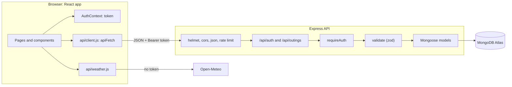

# Meshwar

A weather-aware outing planner for students in Lebanon. Save a hike, a beach day or a ski trip, and Meshwar shows the forecast for that exact day and place, with a plain verdict: **Good to go**, **Bring a jacket**, or **Rain likely, consider rescheduling**.

> The first proposal spelled the name "Mishwar". It is the same project.

**Live app:** _coming with Milestone 4_
**Live API:** _coming with Milestone 4_ (health check: `/api/health`)

**Team:** Wadih Tawk, Alex Achkar, Raymond El-Helou

## Features

- Sign up, log in and log out. Passwords are hashed with bcrypt; login returns a JWT.
- Create an outing: title, activity (hike, beach, ski, picnic, city, other), date, notes, and a place searched by name. The user picks the right match from a list, because "Tripoli" returns Libya first and Lebanon second.
- **My outings:** only your own outings, upcoming ones sorted by date, past ones in their own section.
- **Outing page:** that day's forecast (min and max °C, rain chance, wind) and the verdict. The forecast covers today and the next 14 days; later dates show "Forecast available from <date>". If the weather service has not finished a day's forecast, the app says so instead of guessing a verdict.
- Edit and delete your own outings, with a confirm step before deleting.
- Protection: outing pages redirect to the login page without a token. The API answers 401 without a valid token and 404 for someone else's outing.
- Responsive layout for phone and desktop.

**Verdict rule:** rain chance of 60 % or more → "Rain likely, consider rescheduling". Otherwise a minimum below 12 °C → "Bring a jacket". Otherwise → "Good to go". The rule lives in one function, `client/src/utils/verdict.js`.

## Tech stack

| Layer | Choice |
|---|---|
| Front end | React 19 + Vite, React Router, Context for auth state, plain CSS (Flexbox, Grid, media queries), dayjs |
| Back end | Node.js + Express 5 REST API |
| Database | MongoDB Atlas with Mongoose (collections `users` and `outings`) |
| Authentication | bcrypt password hashes, JWT (1 hour) sent as `Authorization: Bearer`, `requireAuth` middleware |
| Validation and security | zod schemas on every request body, `helmet`, CORS limited to the client URL, rate limits (login: 5 failed tries per 15 minutes), 10 kB body limit, `sanitizeFilter` |
| Third-party API | Open-Meteo Geocoding and Forecast (free, no API key) |
| Tests | Vitest + Supertest (back end), Vitest + React Testing Library (front end) |
| Hosting | API on Render, client on Vercel, database on Atlas |

## Architecture



The app is three programs. The **React app** runs in the browser, draws the screens and keeps the token. The **Express API** is the only program that knows the database password and the token secret, so it is the only one that talks to MongoDB. **MongoDB Atlas** stores users and outings.

The browser talks to two places through two separate files: `apiFetch` for our API (it adds the token to every request) and `weather.js` for Open-Meteo (it never sends our token to another company). The forecast is not stored: it changes every day, so it is fetched live from the outing's saved latitude, longitude and date.

Every outing request passes `requireAuth` (who are you?) and then a database filter on `userId` (is it yours?). That is why another user's outing answers 404.

### Data model

```
users                              outings
_id           ObjectId  ◄───┐      _id        ObjectId
name          String        └───── userId     ObjectId → users (from the token)
email         String unique        title      String, max 80
passwordHash  String (bcrypt)      activity   hike | beach | ski | picnic | city | other
createdAt / updatedAt              place      { name, country, lat, lon }
                                   date       String "YYYY-MM-DD"
                                   notes      String, max 500
                                   createdAt / updatedAt
```

Index: `{ userId: 1, date: 1 }`, which matches the "My outings" query.

### API

| Method and path | Token | Success | Errors |
|---|---|---|---|
| `GET /api/health` | no | 200 `{ ok: true }` | |
| `POST /api/auth/signup` | no | 201 `{ token, user }` | 400, 409 |
| `POST /api/auth/login` | no | 200 `{ token }` | 400, 401, 429 |
| `GET /api/outings` | yes | 200, your outings sorted by date | 401 |
| `POST /api/outings` | yes | 201, the new outing | 400, 401 |
| `GET /api/outings/:id` | yes | 200 | 400, 401, 404 |
| `PUT /api/outings/:id` | yes | 200, the updated outing | 400, 401, 404 |
| `DELETE /api/outings/:id` | yes | 204 | 400, 401, 404 |

### Front-end routes

| URL | Page | Access |
|---|---|---|
| `/login`, `/signup` | Log in, Sign up | anyone |
| `/outings` | My outings | logged in |
| `/outings/new` | New outing | logged in |
| `/outings/:id` | Outing page (forecast + verdict) | logged in |
| `/outings/:id/edit` | Edit outing | logged in |

## Project structure

```
client/                React app (Vite)
  src/api/             apiFetch (our API) and weather.js (Open-Meteo)
  src/auth/            AuthContext and AuthProvider
  src/hooks/           useApi, useForecast
  src/components/      Layout, ProtectedRoute, OutingCard, OutingForm, PlaceSearch, ForecastPanel...
  src/pages/           one file per screen
  src/utils/           verdict rule, dates, formatting
server/                Express API
  app.js               builds the app (middleware, routes, error handler)
  server.js            loads .env, connects to MongoDB, listens
  config.js            stops the server if a required variable is missing
  auth/token.js        signToken, verifyToken
  middleware/          requireAuth, validate (zod schemas)
  models/              User, Outing
  routes/              auth, outings
  tests/               Supertest tests
```

## Run it locally

You need Node.js 22.12 or newer and a MongoDB Atlas connection string.

**1. API** (terminal 1)

```bash
cd server
npm install
cp .env.example .env
```

Fill in `server/.env`:

| Variable | Value |
|---|---|
| `PORT` | `3000` |
| `MONGODB_URI` | your Atlas connection string, with the database name `meshwar` |
| `JWT_SECRET` | a long random string: `node -e "console.log(require('crypto').randomBytes(32).toString('hex'))"` |
| `CLIENT_URL` | `http://localhost:5173` (no trailing slash) |
| `TRUST_PROXY` | leave empty on your laptop. On Render, the number of proxies in front of the API (see Deployment) |

```bash
npm run dev
```

You should see `connected to MongoDB` and `API on 3000`. Check http://localhost:3000/api/health.

**2. Client** (terminal 2)

```bash
cd client
npm install
cp .env.example .env.development
npm run dev
```

`VITE_API_URL` in `client/.env.development` is `http://localhost:3000`. Open http://localhost:5173.

### Troubleshooting

| What you see | Why | Fix |
|---|---|---|
| "Could not reach the server" on every page | The API is not running, or the page was opened as `http://127.0.0.1:5173`. The API only accepts requests from the exact `CLIENT_URL` origin. | Start the API, and open `http://localhost:5173`. |
| "The database is not reachable right now" | The API cannot reach Atlas (no internet, a network that blocks DNS lookups, or your IP is not in Atlas Network Access). The API waits 5 seconds, then answers 503. | Check the connection and the Atlas Network Access list, then retry. |
| The API stops at start with `Missing env var: ...` | A variable is missing from `server/.env`. | Copy `.env.example` to `.env` and fill in every line. |
| "VITE_API_URL is not set" | `client/.env.development` (or the host's setting) is missing. | Create it from `.env.example`, then restart `npm run dev`. |

## Tests

```bash
cd server && npm test
cd client && npm test
```

- **Back end** (`server/tests/outings.test.js`): no token → 401, tampered token → 401, empty title → 400, impossible date → 400, short signup password → 400, an operator in the login email → 400. The tests import `app.js` directly, so they need no database and no open port.
- **Front end** (`client/src/components/OutingCard.test.jsx`, `client/src/utils/verdict.test.js`): an outing card shows "Rain likely" for an 80 % rain forecast, the card links to its page, a far date shows when the forecast starts, the verdict rule including its edges (exactly 60 % and exactly 12 °C), and no verdict when the forecast is incomplete.

GitHub Actions runs both suites on every push (`.github/workflows/ci.yml`).

## Deployment

- **API on Render:** web service, root directory `server`, build `npm ci`, start `npm start`. Environment variables: `MONGODB_URI`, a new `JWT_SECRET` for production, `CLIENT_URL` (the Vercel URL, no trailing slash), `NODE_ENV=production`, and `TRUST_PROXY` (how many proxies sit in front of the API, so the rate limit sees each visitor's real IP address). Render sets `PORT`.
- **Client on Vercel:** root directory `client`, build `npm run build`, output `dist`, environment variable `VITE_API_URL` (the Render URL, no trailing slash). Vite copies this value into the build, so changing it needs a redeploy. `client/vercel.json` sends every path to `index.html`, so refreshing on `/outings/123` works.
- **Atlas:** Network Access allows `0.0.0.0/0`, because Render's free tier has no fixed IP address. The database is protected by its user name and a long random password that only lives in Render's settings.
- The free Render service sleeps after 15 minutes without traffic, so the first request after a pause can take up to a minute.

## Security notes

- `.env` files are git-ignored; only `.env.example` files are committed.
- Passwords are stored only as bcrypt hashes (cost 12). Login gives the same message for an unknown email and a wrong password.
- The owner of an outing always comes from the token, never from the request body. zod drops unknown keys, so `userId` or `role` in a body is ignored.
- Someone else's outing answers 404, not 403, so the API does not confirm that the id exists.

### Known limitations

- Signup answers "Email already registered", and a login with an unknown email answers faster than one with a wrong password, so someone could find out whether an email has an account. The login rate limit slows this down.
- bcrypt only uses the first 72 bytes of a password. Very long passwords with accented letters are cut silently.
- The token lasts one hour. A form left open longer than that is lost when it is saved, and the user has to log in again.
- The API accepts any real date; only the form stops new outings in the past, so the notes of a past outing can still be edited.

## Photos and texts

- Place photos and the short descriptions come from **Wikipedia** (text under CC BY-SA 4.0; each photo keeps the license of its Wikimedia Commons file). The outing page links to the article.
- When Wikipedia has no photo of a place, the app shows a photo for the activity. These six files are in `client/public/photos/`, taken from Wikimedia Commons and resized to 960 px:

| File | Photo | Author | License |
|---|---|---|---|
| `hike.jpg` | [Qadisha Valley, aerial view from Qannoubine Monastery](https://commons.wikimedia.org/wiki/File:Qadisha_Valley,_Aerial_View_From_Qannoubine_Monastery.jpg) | Evan Williams | CC BY-SA 4.0 |
| `beach.jpg` | [Byblos beach, north](https://commons.wikimedia.org/wiki/File:ByblosBeachNorth.jpg) | Elgaard | CC BY-SA 3.0 |
| `ski.jpg` | [Mzaar Ski Resort](https://commons.wikimedia.org/wiki/File:Mzaar_Ski_Resort.jpg) | Sarbast.T.Hameed | CC BY-SA 4.0 |
| `picnic.jpg` | [Cedars of God forest](https://commons.wikimedia.org/wiki/File:Cedars_of_God_(Lebanon_cedar_forests),_Lebanon.jpg) | Vyacheslav Argenberg | CC BY 4.0 |
| `city.jpg` | [Nejmeh Square, Beirut](https://commons.wikimedia.org/wiki/File:Beirut,_Central_District,_Nejmeh_Square.jpg) | Heinz Hövel | CC BY-SA 3.0 |
| `other.jpg` | [Cedar of Lebanon](https://commons.wikimedia.org/wiki/File:Cedar_of_Lebanon_(Cedar_of_God),_Lebanon.jpg) | Vyacheslav Argenberg | CC BY 4.0 |
